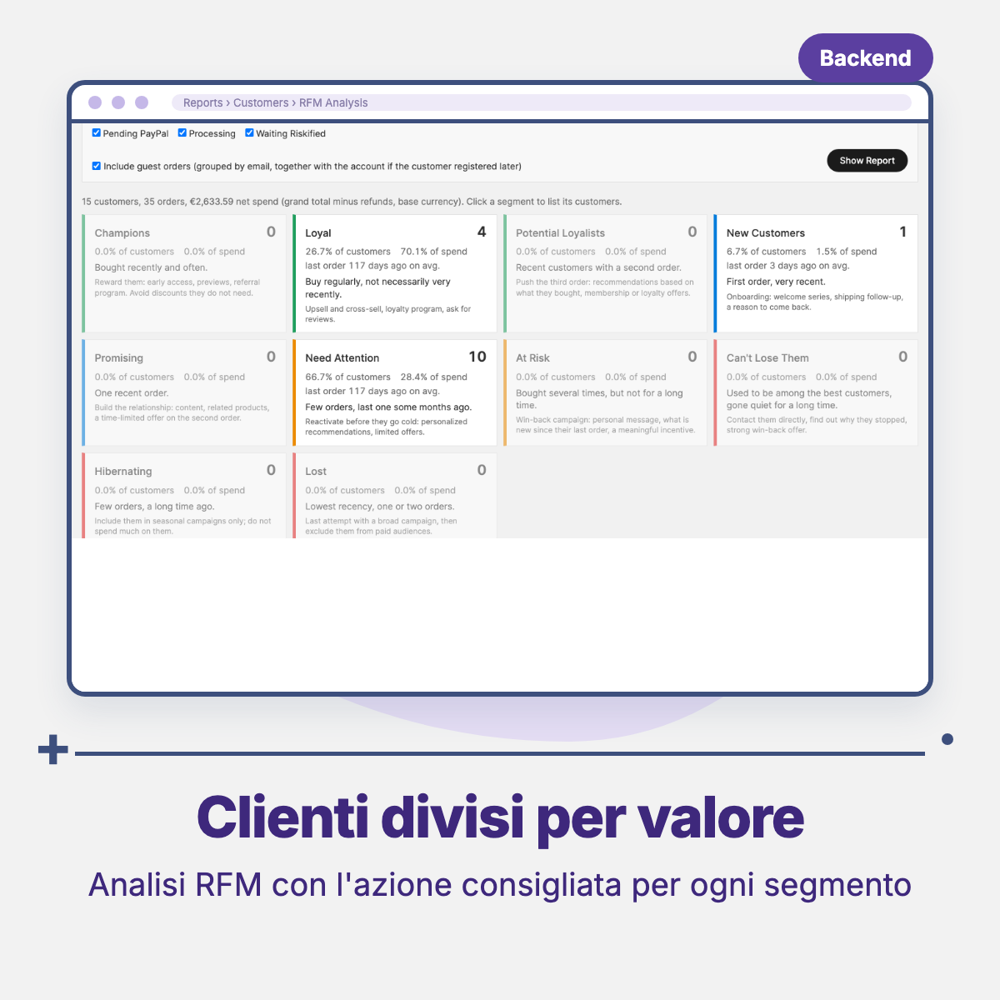
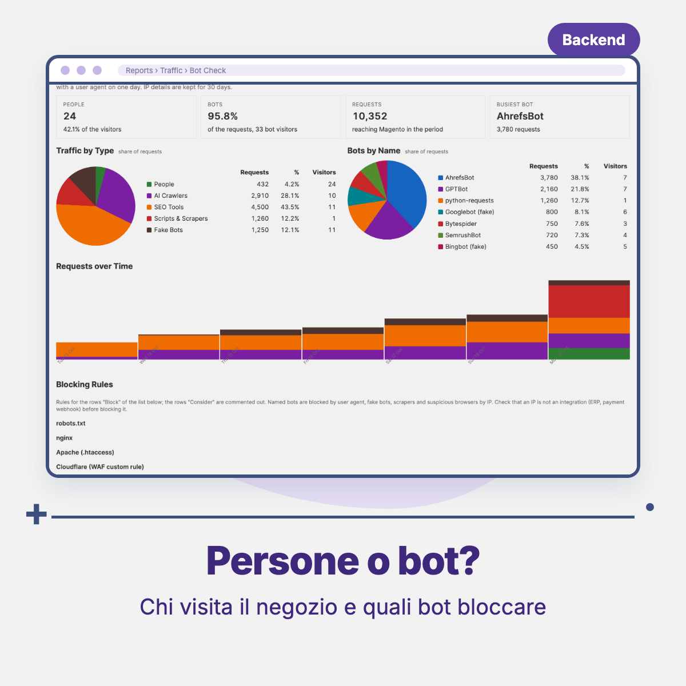

# Threecommerce_Reports: advanced admin reports for Magento 2 / Mage-OS

Native Magento reports tell you how much you sold, not how much you earned, which customers you are losing or which stock is not moving. This module adds **13 ready-made reports** to the admin *Reports* menu, calculated from the data Magento already stores and exportable to CSV or Excel XML.

**Compatibility:** Magento Open Source / Adobe Commerce 2.4.7 – 2.4.9 · Mage-OS 3.x · PHP 8.1 – 8.4 · MySQL 8 / MariaDB 10.6+ · Admin only
**License:** commercial · coming soon

## Features

- **Profitability**: product margin per product or per sold SKU, with net revenue, cost, margin %, markup % and cost coverage.
- **Customers**: RFM analysis (Recency, Frequency, Monetary) with segments and a suggested action for each; inactive customers to win back.
- **Products**: dead stock and stock coverage; product conversion from visits to carts to orders.
- **Marketing**: searches without results.
- **Sales**: fulfillment times, sales geography, hourly heatmap, store comparison; pickups by store (only with Threecommerce Store Pickup) and quote request analysis (only with Threecommerce Catalog Mode).
- **Traffic**: Bot Check, to tell visits by people from bots and get rules to block the useless ones.
- Same structure everywhere: filters for period, store view and order statuses, summary cards, grid with sortable columns, totals row, **CSV and Excel XML export**.
- Reports are computed in real time from existing data: no *Refresh Statistics* needed and no data leaves your server. Only Bot Check collects its own data.
- One **ACL resource per report**, so each admin role sees only the reports it needs.
- The storefront is not modified.

## Requirements

- Magento Open Source / Adobe Commerce 2.4.7+ or Mage-OS 3.x
- PHP 8.1 – 8.4
- MySQL 8 or MariaDB 10.6+
- Native modules: Backend, Catalog, CatalogInventory, Customer, Newsletter, PageCache, Quote, Reports, Sales, Search, Store

## Availability

This module is **not yet available to buy**. It is a commercial product and is coming soon. To be notified when it is released, or to ask for details, use the [product page](https://www.threecommerce.it/report-avanzati-magento-2?utm_source=github&utm_medium=readme&utm_campaign=magento2-reports) or [get in touch](https://www.threecommerce.it/contatti?utm_source=github&utm_medium=readme&utm_campaign=magento2-reports).

## Configuration

Reports appear under *Reports* (Profitability and Traffic are new sections). Optional settings are in *Stores → Configuration → Threecommerce Plugins → Reports*: Google Analytics 4 connection for the product conversion report, and Bot Check options (traffic recording, IP retention, suspicious threshold, client IP header, excluded IPs, Varnish log import). Permissions per report: *System → Permissions → User Roles*.

## Documentation and support

- Product page: [threecommerce.it/report-avanzati-magento-2](https://www.threecommerce.it/report-avanzati-magento-2?utm_source=github&utm_medium=readme&utm_campaign=magento2-reports)
- [Changelog](CHANGELOG.md)
- Support and custom development: [threecommerce.it/contatti](https://www.threecommerce.it/contatti?utm_source=github&utm_medium=readme&utm_campaign=magento2-reports)

---

*This repository is the public showcase of the module. The source code is kept in a private repository.*
